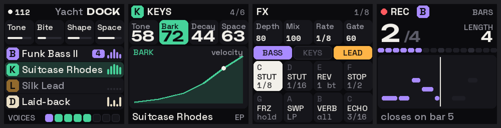

# Dock style guide

How every Dock screen looks and reads on the FM-1. It drives the firmware UI (DOCK.md §9, Phase 1 step 9) and the
emulator. When a screen and this guide disagree, fix one of them: don't let them drift apart.

The references (`dock/ref/*.png`) come from `tools/dock_refs.py`, which uses the tokens, fonts and grid below and
refuses any text that doesn't fit. They're drawn from the "Dock FM-1 Screens" scamps, translated to the real screen.

## 1. Principles

1. **Colour = band member.** Violet is always Bass, green is always Keys, amber is always Lead, bone is always the
   drummer, on strips, badges, keys, LEDs and meters. No other meaning gets a member's colour.
2. **Shapes, not numbers.** Meters, envelopes, rings, voice squares and beat strips read at a glance; numbers are for
   the knob that's turning.
3. **Calm.** A dark ground, soft filled cards, no outlines except where something is picked, no hint rows, no tabs. One
   thing on screen is bright at a time.
4. **Big enough to read.** The panel is 1.54" (27.7 mm across). Nothing is smaller than the 16 px label size.
   (Melodee learned this on hardware and moved to "large type" on 14 Oct 2026; Dock keeps its floor.)
5. **Nothing is cut.** No text is clipped or ellipsised. Labels have short forms (§7); a name too long for its place
   drops a size before anything is cut.
6. **Modern, a little fun.** Space Grotesk's quirks do the work in words; Unbounded's wide, bold figures are saved
   for the big moments.

## 2. The canvas and grid

The screen is **240 × 240 px**, square. All positions are in device pixels. The grid follows Melodee's, proven on
the device:

| Zone | y | Height | What |
|---|---|---|---|
| Header | 0–29 | 30 | wordmark or screen title at x 8 (baseline 22); state at the right (right edge x 232) |
| Knob strip | 32–80 | 48 | four cells **57 × 48** at x = 2 + 60·k, radius 8: Tone · Bite · Shape · Space (or the page's four) |
| Picture / rows | 84–208 | 124 | one picture (a shape), or rows 30 px tall, 32 apart |
| Bar | 212–240 | 28 | the sound's name, the voices, or the state (baseline 232) |

- Side margins: 2 px for cards, 8 px for free text. Gaps between cards: 3–4 px.
- Text inside a knob cell starts 4 px in and may take **49 px**.
- Corner radii: cards 8, rows 7, badges 6, chips 4, small marks 2–3.

## 3. Colour

### Tokens

| Token | Hex | Use |
|---|---|---|
| `BG` | `#0B0B0E` | the ground; text on a member colour |
| `SURFACE` | `#16161B` | cards, rows, cells |
| `RAISED` | `#1E1E25` | things to come (loop notes not yet played, empty beats) |
| `LINE` | `#2A2A33` | gauge tracks, empty voice squares, silent meter dots |
| `TEXT` | `#F2F0EA` | primary text (a warm off-white, never pure white) |
| `MID` | `#9A9AA4` | secondary text: labels, units, a silent member's name |
| `DIM` | `#5C5C68` | tertiary: key letters, bypassed things |
| `REC` | `#FF5A5F` | recording, and only recording |

### The band

| Member | Colour | Hex |
|---|---|---|
| **B: Bass** | Violet | `#A98BFF` |
| **K: Keys** | Green | `#46D39A` |
| **L: Lead** | Amber | `#FFB547` |
| **D: Drums** | Bone | `#E9DFC7` (proposed: a rhythm box's cream; not yet in DOCK.md) |

### States (computed, never hand-picked)

| State | Rule |
|---|---|
| Sounding / active | the member colour |
| Idle (silent member) | 55 % of the colour over `BG` |
| Picked row, a fill behind a shape | 16–18 % of the colour over `SURFACE` |
| Knob turning, chip on, member in | solid member colour, text in `BG` |
| Held (FX key) | `TEXT` fill, text in `BG` |

Status that isn't a member (the clock, BPM, a count) uses `TEXT` or `MID`, never a member colour: the scamps' green
clock dot becomes white, because green means Keys.

## 4. Type

Three faces, all SIL OFL 1.1 (`assets/fonts/`, licences beside them):

| Face | Role | Why |
|---|---|---|
| **Space Grotesk** (500 / 600 / 700) | all words | modern, with quirks (the a, G, t) that stay fun at small sizes |
| **Unbounded** (600 / 700) | big numbers, the **DOCK** wordmark, Line-up names | wide and bold: the fun moments. Only short words: it's too wide for sound names |
| **Space Mono** (400 / 700) | data: channels, voice counts, BPM, rates, key letters | a retro-futurist mono, fitting the 70s/80s; figures line up |

### Roles (sizes match Melodee's firmware roles, so the layout code holds)

| Firmware role | Size | Face | Use |
|---|---|---|---|
| `TY_LB` | 16 px | Space Grotesk 500 | labels, tags, chips, knob names |
| `TY_TX` | 20 px | Space Grotesk 500 (titles 700) | names, rows, the header |
| `TY_VL` | 28 px | Space Grotesk 600, or **Unbounded 600 for figures** | values; a name being browsed |
| `TY_HR` | 48 px | **Unbounded 600** (figures), Space Grotesk 600 (words) | the hero: the bar counter, a big value |
| *(new)* `TY_MONO` | 16 px | Space Mono 400 / 700 | data |
| *(new)* `TY_WORD` | 18 px | Unbounded 700 | the DOCK wordmark, a Line-up's name |

Rules:
- **Case:** knob and parameter names in Title case (Tone, Bark); status tags, member names in the header and FX
  names in CAPITALS (KEYS, STUT, BARS); sound names as they're stored.
- **Figures** at 28 px or bigger are Unbounded; under that, Space Mono.
- A name that doesn't fit its place drops to the next role down (`ty_fit`); it's never cut.

## 5. Components

| Component | Spec |
|---|---|
| **Badge** | 24 × 24, radius 6, member colour (idle: 55 %), its letter in Space Grotesk 700 20 px, `BG`, centred |
| **Member row** (HOME) | 236 × 30, radius 7, `SURFACE` (picked: 18 % tint). Badge at x 5; name `TX` at x 36; optional chip; meter at x 206 |
| **Meter** | five bars 3 px wide, 6 apart, heights from the member's level, in its colour; silent: five 3 px dots in `LINE` |
| **Knob cell** | 57 × 48, radius 8, `SURFACE`. HOME: name `LB` + a 47 × 3 gauge (track `LINE`, fill `TEXT`). Pages: name `LB` in `MID` + value (`VL`, Unbounded). **Turning:** the whole cell fills with the member colour, text in `BG` |
| **Picture** | 236 × 124 at y 84, radius 8. One shape: what the turning knob changes. Its line 3 px in the member colour over an 16 % fill; the point now (a note, a velocity) a 8 px `TEXT` dot. Its name `LB` top left in the member colour. **Nothing covers it**: the value lives in the knob cell |
| **Chip** | 16 px tall, radius 4. On: member colour fill, `BG` text. Off: `SURFACE` with a `LINE` outline, `DIM` text |
| **Browse strip** (HOME) | 236 × 48 in the knob strip's place while a sound is chosen (PRESETS, a Program Change, an undo) and 2 s after: the engine (`LB`, member colour), the category (`LB`, `MID`), the place among that engine's sounds in the list shown (`MN`, `MID`, "JUNO … 2 / 10"). The row shows the sound; while the browser waits to load it, its name is in `ACCENT` |
| **Voice squares** | eight 15 × 15, radius 4, 19 apart: each in its owner's colour; free ones `SURFACE` outlined in `LINE`. The drummer's lane isn't among them |
| **Beat strip** (looper) | 16 marks 12 × 8, radius 3, 15 apart: done in the member colour, to come `RAISED`, downbeats `LINE` |
| **Effect cell** (FX) | 57 × 59: key letter (Space Mono, `DIM`), short name (`LB`, `TEXT`), setting (Space Mono, `MID`). Held: `TEXT` fill, all text `BG` |

## 6. The screens

| Screen | Header | Knob strip | Picture / rows | Bar |
|---|---|---|---|---|
| **HOME** (stage) | clock dot and BPM at the left; the Line-up's name and the DOCK wordmark at the right ("Yacht DOCK") | Tone · Bite · Shape · Space (PART or BAND) with gauges | four member rows: Bass, Keys, Lead, Drums | VOICES + eight squares |
| **FOCUS** (a member) | badge + member name, voices `n/6` | the engine's four, values in Unbounded; the turning one filled | what the turning knob shapes | the sound's name + engine |
| **FX** (FX held) | FX, the sync rate | Depth · Mix · Rate · Gate | who goes through (three chips), then eight effect cells | (none: the cells reach the edge) |
| **LOOPER** (REC) | REC dot, member badge, mode | the bar counter in Unbounded 48 (no knob strip) | beat strip, then the notes with the playhead | what happens next ("closes on bar 5") |

### What changed from the scamps, and why

| Scamp | On the device | Why |
|---|---|---|
| 4:3 landscape, many small texts | 240 × 240 square, four type sizes from 16 px | the real panel, legibility (§1.4) |
| Channel and voice data under each name | on FOCUS only (`CH2`, `4/6`) | a 30 px row has room for one line at 20 px |
| Hint footer ("SELECT · line-up ALGORITHM · edit") | gone; the bar shows state, not instructions | calm; Melodee's reviews dropped hint rows |
| B / K / L tabs on FOCUS | a badge and the member's name | no tabs (the black keys pick the member) |
| Value pop-up over the envelope | the turning knob's own cell fills with the value | nothing covers the picture (Kerem, 15 Oct: a large value over it hid what it shapes) |
| Green clock dot | white | green means Keys |
| Drummer not on HOME | a fourth row, in bone | part 4 is the drummer |

## 7. Words

- **Short forms** keep labels whole: STUT (stutter), REV (reverse), STOP (tape stop), FRZ (freeze), SWP (sweep),
  VERB (verb throw), ECHO (echo throw), `1 bt` (one beat). Knob names are short already: Tone, Bite, Shape, Space,
  Bark, Decay, Depth, Mix, Rate, Gate.
- **Numbers** as the hardware counts them: `CH2`, `4/6`, `1/8`, `112`.
- **Say what happens**, not which button to press: "closes on bar 5", not "press REC to stop".

## 8. In the firmware

- **Fonts:** a `dock` preset in `tools/gen_aa_font.py`: Space Grotesk at 16 / 20 / 28 / 48, Unbounded figures at
  28 / 48 plus the wordmark at 18 (capitals only), Space Mono at 16 (ASCII). Expect roughly 10 KB of flash more than
  Melodee's Rubik set; measure it when built. Melodee Pixel stays as the Settings > FONT alternative.
- **Colours:** a DOCK palette in `tools/gen_ui_palettes.py` with the tokens above; the member colours replace the
  track colours; its contrast checks must pass.
- **Parity:** the firmware draws each reference state in `tests/ui_render.c`; `tools/ui_mockcmp.py` scores it against
  `dock/ref/` the way Melodee scored its redesign. A screen is done at a score of 85 or more and your approval.
- **References:** change a screen's design in `tools/dock_refs.py` first, regenerate, then build it.

## 9. Open

Built so far (firmware, `DOCK_BAND`): the fonts and DOCK palette, HOME (`ui_dock.c`), the pages' header (badge, page,
voices), badge letters in place of track numerals, knob cells as cards with the turning one filled. Still to do on
the pages: the picture on a `SURFACE` card, and values at 28 px in Unbounded (Melodee's values roll digit by digit at
20 px; the roll needs reworking for the larger face). FX and LOOPER come with their features.

- The drummer's colour (bone, proposed here) and its name on HOME (the groove's name, e.g. "Laid-back").
- Whether HOME's knob strip shows PART or BAND with a mark, and how (DOCK.md §6).
- The Line-up picker and the sound browser (not drawn yet).
